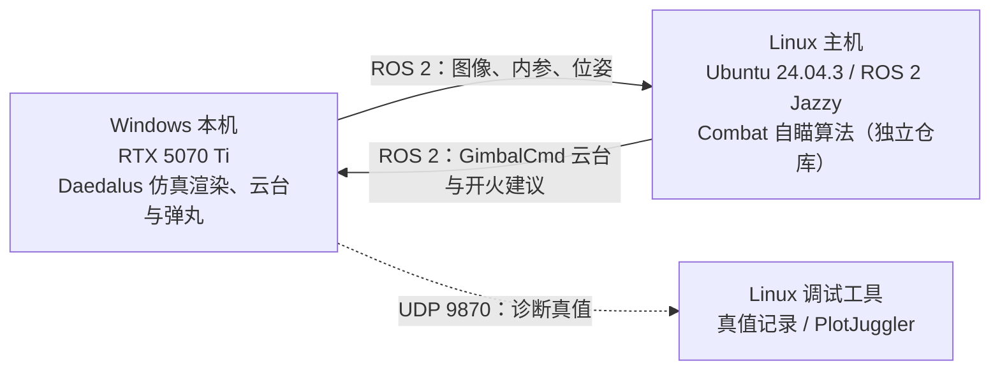

# RM Rune Simulator · Combat 战队自瞄仿真

**南京理工大学江阴校区 Combat 战队的自瞄仿真环境**，基于 [Blackjack200 / Daedalus](https://github.com/Blackjack200/bevy_robomaster_simulator) 适配。

真机迭代的大部分时间花在等：等车、等场地、等一次能完整跑下来的机会。一个下午能试的参数很有限，出了偏差也不容易分清是算法问题还是机械问题。仿真提供的是可重复的单一变量实验，在不占用实车的前提下反复验证自瞄链路上的几个环节：图像采集、检测与跟踪、云台控制、小陀螺预测和开火决策。能量机关场景沿用上游，没有删除。

**我们实际是两台机器一起跑：** Windows 这台（RTX 5070 Ti）负责渲染、物理和云台执行，Linux 那台运行自瞄，两者通过局域网 ROS 2 Jazzy / FastDDS 通信。自瞄算法在独立仓库，本仓库只包含仿真端、接口定义和部署脚本。

> 仓库名沿用 rune，但当前默认场景不是打符，而是 **4 m 前方、7.5 rad/s 恒速旋转的敌方步兵**。自瞄算法、网络权重、真机驱动和 PlotJuggler 本体都不在本仓库内。只运行仿真时，可以看到场景和真值；自动瞄准与自动开火需要接入外部自瞄节点。

## 与上游的差异

这不是上游的升级版，也不是完整复刻。上游 master 已经演进成多目标 / Talos 架构，本仓库是从较早的单体分支整理出来的，面向"Windows 仿真 + Linux 自瞄"这一条闭环。两边解决的问题不同，功能多少不能直接比较。

对比基准：公开上游 `Blackjack200/bevy_robomaster_simulator`，2026-10-23 读到的 master 为 `4368125`（该提交日期是 2026-09-03）。本机原工程没有 `.git`，说不清它最初来自哪个 commit，下表只写能核对到的差异，具体分叉点不知道。

| 环节 | 上游当前 master | 本仓库 | 可核对的变化 |
|---|---|---|---|
| 定位 | 多目标仿真、ROS / Talos | 战队 ROS 图像与自瞄闭环、小陀螺实验 | 面向单条闭环，参数可复现 |
| 引擎 | 已演进，见上游 `Cargo.toml` | 保留 Bevy 0.17.2 / Avian3D 0.4 | — |
| 源码组织 | scene / systems / config，多 crates | 单体 `main` + `ros2` + `power_rune`，新增 `spin` / `shotlog` | `spin.rs` 1069 行、19 个单元测试 |
| 云台接口 | 说明含 armor_solver / Talos | `rune_solver/cmd_gimbal`，固定本机消息定义 | Linux 侧不改接口即可接入 |
| 场景可复现 | 车体可自由漂移 | 敌方 XZ 钉住、我方出生点钉住 | 修掉实测滑走约 **5.4 m** 的问题 |
| 真值 | 无独立真值链路 | UDP 9870 JSON，含云台角、敌方中心、4 块板中心 | 不占用 ROS 真值话题 |
| 命中统计 | 单一计数 | 总命中 / 近侧命中并列，`[HITSTAT]` 每 2 s 落盘 | 命中率从"一个数"变成"能解释的数" |
| 几何一致性 | 15° 内倾只转 `_P`，支点按局部算 | 改到 `AM_n` 父节点、支点 `c_world = t_am + t_p + c` | `{A1,A3}=240.2 mm`、`{A2,A4}=226.2 mm`，档差 14.0 mm 成对一致 |
| 传输 | 默认 DDS 缓冲 | `maxMessageSize=1400` + 8 MB socket buffer | 修掉 q100 帧退化成约 **3 秒一帧** |
| 分发 | 需自行编译 | 版本化 Release 便携包 + 开发构建分离 | 不装 Rust/ROS 也能跑 |

### 具体改动

**1. 接口对齐现有自瞄**

`rm_interfaces` 消息与服务源码随仓库发布，`GimbalCmd` 的度转弧度在 `src/ros2/plugin.rs` 完成。仿真订阅 `/rune_solver/cmd_gimbal`，并作为客户端调用 `set_mode`；服务缺失只告警，不算启动失败。这样 Linux 侧不用为了仿真改接口。

**2. 场景从"能跑"变成"能复现"**

- 新增 `src/spin.rs`：5 种旋转模式、f64 积分、固定随机种子，1069 行、19 个单元测试。相对本机改造前的固定自转场景，多了变速与换向的实验能力；上游后续版本有没有这些能力，这里不下判断。
- 敌方 XZ 固定（`ENEMY_X` / `ENEMY_Z`），我方出生点钉住、按键解除（`PIN_LOCAL_INFANTRY`）。原因是车体 `LinearDamping=0` 且出生点与符重合，实测会滑走约 5.4 m，"前方 4 m"就不可复现。
- 运动同时写 `Transform` 与物理 `Rotation`。只写前者会被物理回写覆盖，姿态滞后一个固定步，18 rad/s 时约 10°。

**3. 真值独立成链路**

- UDP 9870 输出 JSON，含云台角与位置、敌方中心、4 块板中心、`spin_*` 状态；不占用 ROS 真值话题，也不影响自瞄订阅。
- 板中心取 mesh 顶点世界质心，不取节点原点。GLB 里 `ARMOR_n_P` 相对 BASE 的净变换是单位阵，节点原点会退化成同一点，4 块板报成同一个位置。
- 代价是跨程序比较前必须统一坐标、单位、时钟和采样时刻，否则数字对不上。

**4. 命中率从"一个数"变成"能解释的数"**

- `statistic.rs` 并列总命中与近侧命中，`[HITSTAT]` 每 2 s 落日志，后台运行也能读。
- `shotlog.rs` 逐发记录 req / launch / hit / miss，用 `shot_id` 严格关联，可以算 fire→launch 延迟。
- 两者都只观测，不改变开火决策；`SHOT_LOG` 不设时模块整体短路。

**5. 几何一致性修正（本仓库最实质的 bug fix）**

- 15° 内倾改到 `AM_n` 父节点上，灯条、编号、模块一起倾斜。只转 `_P` 会导致画面竖直、真值内倾，两者对不上。
- 支点改为 `c_world = t_am + t_p + c`。旧写法 `c_local = t_p + c` 让 `AM_3/AM_4` 绕车心旋转，板心竖直错位约 57 mm；修复后 `{A1,A3}=240.2 mm`、`{A2,A4}=226.2 mm`，档差 14.0 mm 成对一致。
- 代理面尺寸归一到 137.80×59.84 mm（GLB 灯条外缘）。与自瞄 PnP 的 135.7×56 mm 模型仍有约 +1.5% / +6.9% 差异，属于已知残差，不是"完全对齐"。

**6. 传输与诊断**

- FastDDS `maxMessageSize=1400` + 8 MB socket buffer。q100 帧约 196 KB，默认 65500 会触发 IP 分片，实测退化成约 3 秒一帧。
- `[CAM]` 每 2 s 输出采集、回读、发送失败统计，用来区分"没出图"和"出了图发不出去"。
- `IMAGE_PUB`、`JPEG_QUALITY`、`CAPTURE_WIDTH/HEIGHT` 可配，改分辨率后内参由 `/camera_info` 重算。

**7. 构建与分发可复现**

- `Cargo.lock`、`rust-toolchain.toml`、`pixi.lock`、ROS 包 URL 与 SHA256 全部入库。
- 运行包与开发构建分离：默认启动不会误用本地未更新的编译产物。
- 新入口支持配置覆盖和自动 MSVC 检测，不再启动时强杀进程，也不再要求"必须先有 exe 才能编译"。

## 双机运行方式



| 机器 | 配置 | 在联调中的职责 |
|---|---|---|
| Windows 仿真机 | RTX 5070 Ti（运行日志认成 RTX 5070 Ti Laptop GPU） | GPU 渲染、模拟相机、物理与云台执行、发布图像和姿态 |
| Linux 自瞄主机 | Ubuntu 24.04.3 LTS / x86_64、约 31 GiB 内存、Intel 集显，无独显 | 运行自瞄，接收图像与姿态，输出控制指令；配置使用 OpenVINO 2024.6.0 / CPU 推理 |
| 两机通信 | ROS 2 Jazzy / FastDDS，使用相同 `ROS_DOMAIN_ID`（当前为 25） | 图像与控制走 ROS 2，诊断真值单独走 UDP |

Linux 侧配置照战队给的主机资料整理，没有远程登录复测。显卡型号写的是当前开发机，不要求其他队员用同样的硬件。双机配置与启动步骤见 [双机联调说明](docs/DEPLOYMENT.md)。

## 快速运行

```powershell
git clone https://github.com/MalzaharGeng/RM_rune_simulator.git
cd RM_rune_simulator

# 首次需要下载 Release。私有仓库需先 gh auth login，并具有协作者权限。
powershell -NoProfile -ExecutionPolicy Bypass -File scripts/download-runtime.ps1
.\start_rune_simulator.bat
```

也可以从 Release 手动下载 `windows-runtime-2026.10.23-x64.zip`：

```powershell
powershell -NoProfile -ExecutionPolicy Bypass -File scripts/download-runtime.ps1 -Archive C:\Downloads\windows-runtime-2026.10.23-x64.zip
```

下载脚本会先校验仓库中记录的 SHA256，再解压到 `.runtime/windows/`。双击 `start_rune_simulator.bat` 即可启动。启动脚本不会终止其他仿真进程，也不会在每次启动时重新编译。

便携包用的是本机 **2026-10-13 编译出来的版本**，发布时没有重编整个仿真器。改源码请走下面的开发入口。可执行程序和 ROS DLL 放在版本化的 [Release](https://github.com/MalzaharGeng/RM_rune_simulator/releases/tag/v2026.10.23)，不需要装 Rust、ROS、Python 或 Visual Studio，但需要 Windows x64 和支持 Bevy/wgpu 的显卡驱动。

## 修改与构建

先安装 **Git、Rust/rustup、Pixi、Visual Studio 2022 C++ Build Tools（含 Windows SDK）及 LLVM/libclang**。具体版本、安装命令和已有环境接入方式见 [环境说明](docs/ENVIRONMENT.md)。

```powershell
# 下载并校验固定版本 ROS，按 pixi.lock 安装依赖，再编译 rm_interfaces
powershell -NoProfile -ExecutionPolicy Bypass -File scripts/bootstrap-windows.ps1

# 完整构建、运行既有单元测试、运行修改后的程序
powershell -NoProfile -ExecutionPolicy Bypass -File scripts/build.ps1
powershell -NoProfile -ExecutionPolicy Bypass -File scripts/build.ps1 -Test
powershell -NoProfile -ExecutionPolicy Bypass -File scripts/run.ps1 -Source
```

首次安装环境和构建耗时较长，并需要额外磁盘空间；编译缓存不进入 Git。`Cargo.lock` 锁定 Rust 依赖，`env/windows/pixi.lock` 锁定 Windows 侧 ROS 依赖。

运行包下载与本机开发构建是两个独立入口，默认启动不会误用未更新的本地编译结果。

## 配置实验

```powershell
Copy-Item config/local.example.json config/local.json
```

编辑 `config/local.json`。例如把真值发到另一台机器：

```json
{
  "GT_UDP_TARGET": "192.168.1.100:9870",
  "ROS_DOMAIN_ID": "25",
  "SPIN_MODE": "slow",
  "SPIN_SLOW_OMEGA": "7.5"
}
```

`local.json` 只存在于本机，不会被提交。优先级为 **local.json > 当前进程环境变量 > defaults.json**。跨机使用时，两端 `ROS_DOMAIN_ID` 必须一致，地址需可达，并检查 DDS/UDP 防火墙规则。

| 配置 | 默认值 | 用途 |
|---|---|---|
| `ROS_DOMAIN_ID` / `RMW_IMPLEMENTATION` | `25` / `rmw_fastrtps_cpp` | ROS 发现与 FastDDS |
| `GT_UDP_TARGET` / `GT_UDP_ENABLE` | `127.0.0.1:9870` / `1` | 独立 JSON 真值；跨机时修改目标地址 |
| `SPIN_MODE` / `SPIN_SLOW_OMEGA` | `slow` / `7.5` rad/s | 当前恒速小陀螺场景 |
| `ENEMY_X` / `ENEMY_Z` | `0` / `-4` m | 敌方在 Bevy 世界 XZ 平面上的位置 |
| `PIN_LOCAL_INFANTRY` | `1` | 我方固定在出生点；在跟随视角按 WASD/QE 后解除 |
| `ARMOR_TILT_DEG` | `15`° | 装甲板内倾；设 `0` 可对照竖直安装 |
| `IMAGE_PUB` | `compressed` | `raw` / `compressed` / `both` / `none` |
| `JPEG_QUALITY` | `100` | JPEG 质量；q100 仍是 JPEG，不能视为严格无损 |
| `CAPTURE_WIDTH` / `CAPTURE_HEIGHT` | `960` / `720` | 采集尺寸，影响内参与带宽 |
| `SHOT_LOG` | 未设置 | 设为文件路径后，记录逐发事件 |

五种旋转模式：`slow` 恒速；`triangle` 线性往返、无保持段；`constant` 加速到上限后保持；`regular` 在上下限间交替并保持 0.35 s；`irregular` 使用固定种子的随机速度与保持时间。后三种可通过 `SPIN_ALPHA`、`SPIN_MIN/MAX`、`SPIN_HOLD_MIN/MAX`、`SPIN_SEED` 调整。

三角波示例：`SPIN_MODE=triangle`、`SPIN_MIN=-4`、`SPIN_MAX=4`、`SPIN_T_ACC=0.5`，对应角加速度绝对值 16 rad/s²、周期 1 s。

直接运行 exe、绕开发布脚本时，**源码默认是 triangle / [-4,4]，不是 slow / 7.5**。这是两套不同的默认值，排查时先确认入口。

## ROS 2 与真值接口

| 方向 | 接口 | 类型 / 说明 |
|---|---|---|
| 仿真发布 | `/image_compressed` | `sensor_msgs/msg/CompressedImage`，默认开启 |
| 仿真发布 | `/image_raw` | `sensor_msgs/msg/Image`，由 `IMAGE_PUB` 控制 |
| 仿真发布 | `/camera_info` | `sensor_msgs/msg/CameraInfo` |
| 仿真发布 | `/tf` | `tf2_msgs/msg/TFMessage` |
| 仿真发布 | `/gimbal_pose`、`/odom_pose`、`/camera_pose` | `geometry_msgs/msg/PoseStamped` |
| 仿真订阅 | `/rune_solver/cmd_gimbal` | `rm_interfaces/msg/GimbalCmd`，sensor_data QoS |
| 仿真作为客户端 | `/rune_detector/set_mode`、`/rune_solver/set_mode` | `rm_interfaces/srv/SetMode`，请求 mode=2；服务缺失不等于仿真启动失败 |
| 仿真发送 | UDP `9870` | JSON：`timestamp` + `gt`，独立于 ROS 图像链路 |

`GimbalCmd` 中的 `yaw/pitch/yaw_diff/pitch_diff` 使用**度**，仿真接收后转为弧度；`distance` 为米，`fire_advice` 为开火建议。位姿四元数和 UDP 真值按各自的 ROS/三维坐标约定使用，UDP 中的角度为 **rad**。命令字段的度数与真值弧度不能直接相减，比较前必须先统一单位。

UDP 真值包含云台角和位置、敌方中心、4 块装甲板中心，以及 `spin_mode/angle/omega/alpha/target/phase/event_t/t_acc`。坐标转换在 `src/ros2/plugin.rs`。跨程序比较前，需要先统一坐标、单位、时钟和采样时刻。

真值不是 `/gt` ROS 话题，敌方装甲板真值也不通过 `/tf` 的 `enemy_armor` 帧提供，只从 UDP 输出。

**相机部分：** 垂直 FOV 固定 **45°**，没有环境变量可以修改。960×720 下理想内参约为 `fx=fy=869.1169, cx=480, cy=360`，无镜头畸变。

现有 `sp_vision_25` 接入使用 YAML 内参，不消费 `/camera_info`。修改分辨率后，需要同步修改算法端的内参和 ROI，或者先实现并验证 CameraInfo 消费逻辑。

## 能测试什么

| 测试目标 | 可用场景 / 数据 | 判定重点 |
|---|---|---|
| 检测与 PnP | 装甲板图像、四角点诊断、装甲板真值 | 漏检、角点重投影、距离/姿态误差 |
| 跟踪与预测 | 五种旋转模式、可调距离/方位、固定随机种子 | 角速度估计、换板、变速与换向响应 |
| 云台闭环 | GimbalCmd → 实际姿态 → 图像反馈 | 跟踪误差、控制频率、失联行为 |
| 开火策略 | 发射/总命中/近侧命中、逐发事件 | 命中率与发射率同时评估，并计入预热时间 |
| 图像链路 | raw/JPEG、分辨率与质量配置、`[CAM]` | 接收帧率、延迟、发送失败、带宽 |
| 几何一致性 | 15° 内倾与支点修复、板中心与图像 | 对称性、渲染/代理面/算法模型的差异 |
| 能量机关联调 | 继承的小/大符场景及模式服务 | 外观、旋转与激活流程；需接外部算法实测 |

**采集真值时顺序不能反：先启动监听工具，再启动仿真。**

```powershell
python tools/udp_gt_capture.py 20 9870 logs/gt.jsonl
python tools/verify_spin_gt.py logs/gt.jsonl 4 14
# 若采用上面的 [-4,4] 三角波场景，最后两个参数改为 -4 4
```

更多步骤、A/B 模板和已经跑过的检查见 [测试手册](docs/TESTING.md)。历史日志的原始计数和这次的验证输出见 [证据说明](docs/evidence/README.md)。

命中率两个数的口径：

- `infantry_pct` = 总步兵命中数 / 发射数
- `infantry_near_pct` = 近侧命中数 / 发射数

near 表示命中时被击中的板外法线朝向炮口，它不等价于"算法选中了目标板"，也不等于真机命中率。

当前实现允许弹丸穿过车体继续飞行，多板命中与未到期弹丸都会影响快照口径。因此统计应使用逐发事件去重，并在停止开火后等待超过 2 s 再取最终结果。

历史 FINAL 日志最后一条快照为 **1729 发 / 1700 次总命中 / 1637 次近侧命中（98.32% / 94.68%）**。这是当时 Windows 仿真与 Linux 自瞄组合的记录；换机器、换算法或改配置后，不应直接引用该数字。

历史自瞄中的 pose 门和 25 s 预热门属于外部 Linux 程序，本仓库不包含这部分实现。

## 哪些不是我们做的

避免把上游能力算成新增：

- 上游既有的能量机关、装甲板、视角控制等功能，本仓库只是继承，不计为新增。
- 上游 master 的多目标 / Talos 能力，本仓库**没有**。
- Linux 侧自瞄算法、pose 开火门、25 s 预热门、显示去白边与缩放，都不在本仓库。
- FOV 环境变量**没有落地**，垂直 FOV 仍是 45° 硬编码。
- 135×56 mm 的装甲板尺寸尝试**已回滚**，当前是 137.80×59.84 mm。
- 自动导出训练集**没有完成**；`SHOT_LOG` 在缺请求或重复命中时可能含 NaN。

完整归因、已回滚的尝试和未实施的建议见 [上游对比](docs/UPSTREAM_COMPARISON.md)。

## 目录结构

```text
Cargo.toml / Cargo.lock / rust-toolchain.toml
src/                    Rust 源码
  assets/               3 个 GLB + 2 个音效，编译时嵌入
  ros2/                 图像、控制、TF、UDP 真值
  spin.rs / shotlog.rs  旋转曲线与逐发日志
rm_interfaces/          与本机版本对应的 ROS 消息/服务源码
config/                 团队默认配置、个人覆盖示例
env/                    运行包校验信息、ROS/Pixi 固定版本清单
scripts/                下载、环境安装、编译、运行
tools/                  真值采集/验证、模型检查、图像测速
docs/                   环境、改动对比、测试与证据
DEFAULT_FASTRTPS_PROFILES.xml
start_rune_simulator.bat
```

模型保留在 `src/assets/`，以兼容原有 `embedded_asset!` 路径。最大模型约 72 MB，可直接随普通 Git 克隆，无须 Git LFS。缓存、旧源码快照、实验日志、个人配置和编译器安装目录不提交。

## 已知边界与排障

- **DLL 缺失 / `0xC0000135`**：先校验并重装运行包，使用仓库入口；开发模式检查 ROS、Pixi 和消息 overlay 的 PATH。
- **收不到图像**：检查两端 domain、消息类型、QoS、网卡和防火墙；保留根目录 FastDDS XML 及其原文件名，不要叠加另一个同名 transport 配置文件。
- **内参不一致**：确认图像真实尺寸，并核对算法是否确实订阅 CameraInfo，不能只看仿真是否发布。
- **当前没有**完整的曝光/畸变/噪声/电机动力学/真实遮挡和空气阻力模型。弹丸碰撞球直径 **44.5 mm**、质量 44.5 g、线性阻尼 0.05、初速 25 m/s；不能按 17 mm 真机弹丸解释命中率。2 s 寿命也不适合长滞空实验。
- 四角点诊断和 dataset 模块还在，但写图/标注流程没接完，现在还不能说训练集能自动导出。`SHOT_LOG` 在缺少请求或重复命中时可能含 NaN，严格 JSON 解析器要单独处理。
- 本机验证不覆盖另一台全新 Windows 的开发环境安装，也不覆盖跨机 Linux 自瞄和真机实弹；团队上手时按测试手册走一遍。
- 旧 `verify_spin_gt.py` 的系统时间积分判据可能跟 Bevy 仿真时间对不上。短时样本里这项不过，三角波内部换向周期、过冲修正积分和板位刚性都过。粗判据不等于严格物理校验。

## 团队协作

2026-10-31 又对了一遍本机活跃源码、模型/音效、Cargo 依赖文件、FastDDS 配置和现有可执行文件，都与已发布版本一致，运行包继续用 `v2026.10.23`。

- 从 `main` 新建分支，通过 Pull Request 合并。
- 修改场景参数优先使用个人配置，不改默认值。
- 修改消息定义时，两端重新编译并 source 同一版本，否则容易出现类型不匹配、到运行期才暴露的问题。
- 提交功能时附上测试配置、日志窗口、近侧/总命中、发射率和帧率。只给单一最高命中率，无法判断改进是否成立。
- 私有仓库由所有者在 Settings → Collaborators 邀请队员。

## 来源与许可证

上游背景见 [河北科技大学 Actor&Thinker 战队 RM2026 视觉算法仿真器开源](https://bbs.robomaster.com/article/1887395?source=4)。原作者为 Blackjack200 / Actor&Thinker，本仓库维护者 [MalzaharGeng](https://github.com/MalzaharGeng)。许可证沿用 **AGPL-3.0**，自定义消息包保留上游的 Apache-2.0。
